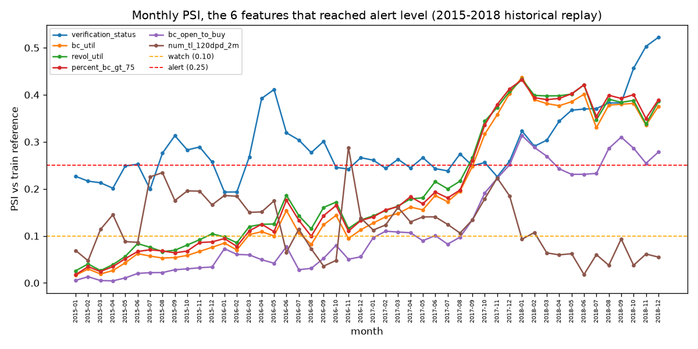
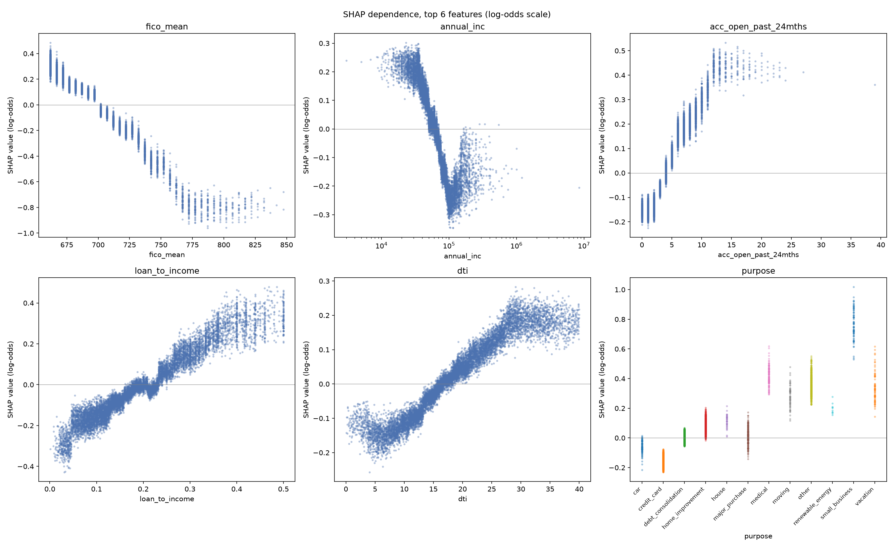

# Credit Default Risk Engine

[](https://github.com/Niveditha-04/Credit-Default-Risk-Engine/actions/workflows/ci.yml)

I built an origination-time credit scoring model for 36-month LendingClub loans: given only what LendingClub knew the moment it accepted a loan, predict the probability that loan ends in default. This is loan selection among loans LendingClub has already accepted, the view an investor buying into these loans would take, not an underwriting model deciding who gets a loan in the first place. I used LendingClub's accepted-loan data, 2007 to 2018, with a time-based split throughout (train 2012-2013, validation 2014, test 2015).

This project is both a credit-modelling exercise and an MLOps one: the scorecard-vs-LightGBM comparison answers the modelling question, and the rest (MLflow run tracking, a tested FastAPI service, Docker, CI, drift monitoring) exists to demonstrate running that model the way a production system would, not just producing one accuracy number.

## Results at a glance

- LightGBM beats LendingClub's own sub_grade (+0.0086 AUC) and the scorecard baseline (+0.0162 AUC) on test (2015), in 12 of 12 months (`reports/metrics/posthoc_monthly_lift.csv`).
- At matched 70% funding, realized return per dollar over the loan's life: LightGBM 7.57%, scorecard 7.28%, sub_grade 6.97%. The differences are significant at 0%, 4%, and 8% annual cost of funds, and the gap vs. sub_grade widens as cost of funds rises (`reports/metrics/posthoc_matched_volume_comparison_table.csv`).
- Refitting on 2012-2014 (one more year, same frozen hyperparameters) raises 2015 AUC from 0.6872 to 0.6962 - retraining on the latest resolved year matters (walk-forward check, `reports/metrics/posthoc_walkforward.csv`).
- A monotone-constrained variant costs about 0.0001 validation AUC and removes most of the income non-monotonicity I found in SHAP; I recommend it for a next model-selection round (`reports/metrics/posthoc_ablations_summary.json`).

## Data

I used LendingClub's accepted-loan data, 2007 to 2018, from a public Kaggle copy uploaded by Nathan George (listed as CC0). The original data was published under LendingClub's own terms at the time. I do not redistribute the raw file; it stays local and gitignored.

- Raw file: `accepted_2007_to_2018Q4.csv.gz`, SHA-256 `dd972c625896155b388224f3ce729e921dae7a9278af579f5a1d72ab49b632ce` (`reports/metrics/raw_data_profile.json`). 2,260,701 rows, 151 columns, 33 footer/summary rows removed, 2,260,668 real loan rows left. My modeling population: 36-month, individual-application loans only. Time-based split, so I never shuffle across time:

| Split | Issue years | Loans | Default rate | Use |
|---|---|---|---|---|
| Train | 2012 to 2013 | 143,892 | 12.70% | Fit models, bin variables, estimate the loss rate |
| Validation | 2014 | 162,570 | 13.73% | Tune, calibrate, choose the selection threshold |
| Test | 2015 | 282,787 | 14.88% | Scored once, at the end, for the final numbers |
| Replay | 2016 to 2018 | 919,053 | not used | Drift checks only, outcomes not yet resolved for most of this window |

I start the modelling population at 2012 for two reasons: 36-month loans issued 2007 to 2011 are only 31,534 loans total, and a wave of bureau trade-line fields (`mths_since_recent_inq`, `bc_util`, and others) does not exist in LendingClub's schema before 2012, arriving between March and August that year (`reports/metrics/field_rollout.csv`). I use 36-month loans only because 60-month loans issued after 2013 are not fully resolved by this data's March 2019 snapshot (82.85% resolved for 2014, 67.08% for 2015, versus 99.97%+ for 36-month loans issued through 2013) - see `reports/metrics/maturity_audit.csv`. Replay (2016 to 2018) carries no labels for the same reason at a larger scale: by the March 2019 snapshot, as little as 11.97% of 2018's 36-month loans have resolved. In the 2015 test population, 147 loans were still unresolved (72 Current, 61 Late 31-120 days, 9 In Grace Period, 5 Late 16-30 days) and are excluded from the labeled population, not counted as either outcome.

## How I defined default, and my approach

Target is 1 if `loan_status` is Charged Off or Default, 0 if Fully Paid (a loan that pays off early cannot default afterward, so I count it as 0, not excluded). I exclude Current, In Grace Period, both Late buckets, and any "does not meet the credit policy" loan, since none of those have a resolved outcome yet - this is lifetime default of a 36-month loan, not default within some fixed window after issuance.

- Built an explicit allow-list for all 151 raw columns: 59 kept as model features, 12 kept as metadata only (dates, state, zip, grade, for filtering and stability checks, never fed to a model), 1 is the target source (`loan_status`), 79 dropped.
- Engineered 10 features from origination-time data only: `fico_mean`, `credit_history_months`, `loan_to_income`, `revol_bal_to_income`, and 6 "never happened yet" flags for the `mths_since_*` columns.
- Built a WOE-binned logistic scorecard as the baseline, then trained LightGBM as the main model and XGBoost as a comparison, both tuned and calibrated on validation only and logged to MLflow.
- Picked one selection cutoff on validation by maximizing total expected net value, then applied that same fixed cutoff to test, once.
- Explained every prediction with LightGBM's own exact TreeSHAP on the full test set, served the champion through FastAPI with reason codes in a Docker image, and checked drift over 2016 to 2018 with PSI as a historical replay.
- Tested the target logic, population filters, PSI math, and the API in CI.

## Results on test (2015)

| Model | AUC (95% CI) | Gini | KS | Brier | Brier skill score | AUC diff vs. LightGBM (95% CI) |
|---|---|---|---|---|---|---|
| LightGBM (champion) | 0.6872 (0.6847 to 0.6898) | 0.3745 | 0.2697 | 0.1197 | 0.0555 | n/a |
| XGBoost (comparison) | 0.6886 (0.6859 to 0.6912) | 0.3772 | 0.2725 | 0.1195 | 0.0564 | -0.0014 (-0.0020 to -0.0008) |
| Scorecard | 0.6711 (0.6686 to 0.6735) | 0.3421 | 0.2480 | 0.1211 | 0.0445 | +0.0162 (0.0146 to 0.0178) |
| LendingClub sub_grade | 0.6786 (0.6760 to 0.6812) | 0.3573 | 0.2619 | 0.1215 | 0.0407 | +0.0086 (0.0063 to 0.0109) |

All three differences are statistically significant (95% bootstrap CI, 1,000 resamples). XGBoost edges out LightGBM by a small but significant margin; both gradient-boosted models beat the scorecard and sub_grade by a larger margin. I deployed LightGBM anyway: it is within 0.0021 AUC of XGBoost on validation, using 273 trees against XGBoost's 2,122 (both searches ran 20 tuning trials; the tree-count gap comes mostly from LightGBM's higher learning rate, 0.08 against XGBoost's 0.01). Retraining noise alone moves validation AUC by about 0.0007 (`reports/metrics/training_order_sensitivity.json`), so I treat the two as statistically detectable but effectively tied.

An AUC around 0.69 should be read against this population, not a general lending population: LendingClub's own underwriting already screens out the riskiest applicants before this data exists at all - every loan here has FICO >= 660 and DTI <= 34.99% (`src/api/feature_ranges.json`, train). Restricting the range of a predictor mechanically compresses the variance a model has to separate classes with, which pulls AUC down relative to what the same model would score on an unrestricted population that still included the applicants LendingClub rejected. I do not cite external AUC benchmarks for comparison here, since I have not verified any specific source closely enough to stand behind its number.

A statistically significant AUC gap does not mean a large difference in money: at a fixed 70/80/90% selection-rate sweep with cutoffs set on validation, LightGBM and the scorecard realize nearly the same cash (0 to 1.1% apart), since riskier loans carry higher interest and a ranking advantage mostly cancels out at the portfolio level under that cutoff methodology. The full sweep table is in `docs/validation_report.md`; the matched-funding-volume comparison below, which ranks by each model's own score instead, does show a significant edge.

## Key findings

- My ex-ante expected net value ($276.2M) overstates the actual realized net cash ($231.6M) by $44.6M (16.2% of ex-ante). Breaking that gap down by cause:

| Cause | $M | % of gap |
|---|---|---|
| Default-rate drift (calibration fit on 2014 at 13.73% default, test 2015 ran at 14.88%) | $21.9M | 49.1% |
| Prepayment (fully paid test loans collected less of their scheduled interest than train-year fully paid loans did, 80.24% vs. 82.62%) | $12.9M | 29.0% |
| Loss severity (charged-off test loans lost more of their funded amount than train-year charged-off loans did, 39.47% vs. 38.03%) | $7.3M | 16.4% |
| Unexplained | $2.4M | 5.5% |

I subtract default-rate drift first, then split what's left between prepayment and loss severity, so that split specifically depends on the order; a different order could move money between those two rows without changing the total explained. Taken together rather than split, prepayment and loss severity are jointly $20.3M (45.4% of the gap), both train-year cash-flow assumptions that didn't hold on test, independent of how they're split from each other.
- Loss on a charged-off loan: I use loss rate on funded amount (cash basis), `1 - (total payment received - collection/recovery fee) / funded amount`, averaging 38.03% on train charged-off loans. The standard LGD on outstanding principal averages 89.06% on the same loans; I use the cash-basis version because it matches dollars actually paid.
- A stricter selection policy means less total cash, not more: LightGBM realizes $196.8M at 70% selection and $228.3M at 90%, against $231.6M for the chosen policy (99.41% of test loans selected), since riskier loans also carry higher interest. No cost of capital, operating cost, or time value of money here, and this is accepted-loans-only data.
- A stricter robustness check (default within 24 months of issue) gives a different default rate (11.93% vs. 14.88%) but the same model ranking: XGBoost, LightGBM, sub_grade, scorecard, on both labels.

## Ablations and robustness (post-hoc)

Four ablations with the champion's frozen hyperparameters (no tuning search), validation (2014) primary, test (2015) **post-hoc**: the scorecard's 17 features alone in LightGBM score 0.6738 validation AUC (vs. the deployed scorecard's own 0.6650); skipping the scorecard's correlation/VIF reduction entirely and fitting WOE logistic regression on all 63 candidates scores 0.6684, slightly *above* the deployed, reduced scorecard, but with 15 sign-mismatched coefficients - that reduction step buys stability, not AUC. Adding `sub_grade` to the champion's 69 features still adds +0.0057, and that combination also wins on realized economics: sub_grade + LightGBM beats sub_grade alone at matched funding volume in both 2014 (9.58% vs. 8.86% return per dollar at 70% funded) and 2015 (7.49% vs. 6.98%). A monotone-constrained variant has no detectable AUC cost (-0.0001, within the 0.0007 retraining-noise spread measured from row order alone).

**Walk-forward**: fold 1 (train 2012-2013, evaluate 2014) is in-sample for this configuration's own tuning and calibration, not a clean holdout - only fold 2 (train 2012-2014, evaluate test 2015) is genuinely out-of-sample. Per fold: +0.0184 / +0.0223 lift vs. the scorecard, +0.0238 / +0.0175 vs. sub_grade - positive in both, including the one fold that counts.

**Pre-registered v2 check**: before running any v2 code, I committed `docs/v2_decision_rule.md` defining v2 (LightGBM refit on 2012-2014, frozen hyperparameters, monotone constraints) and an adoption rule (AUC within 0.002 of v1, ECE within 0.005), to be evaluated on 2016 vintages (issue <= Oct 2016, 24-month label). Result: v1 AUC 0.6899/ECE 0.0080, v2 AUC 0.6978/ECE 0.0079 - v2 beats v1 on both and the rule says **adopt v2**. This does not change the frozen v1 champion (verified: parity and alias checks still pass); it is a recorded decision, not a promotion.

At 8% annual cost of funds (an approximate cost model: rate x funded amount x average outstanding balance over the loan's observed life), every model's *best achievable funding fraction* still loses money - not just at full funding, and not just LightGBM's (`reports/metrics/posthoc_funding_optimization_optimal.csv`). A 24-month default check on replay (exploratory, post-hoc, restricted to vintages with a 5-month seasoning buffer past the 24-month horizon) is consistent with no large degradation: AUC 0.6725 to 0.7045 across 5 replay quarters, overlapping test's 0.6877 to 0.7009 under the same label.

Full ablation table, the monthly-lift breakdown (note: months share macro conditions, so "12 of 12 positive" is not 12 independent confirmations), walk-forward fold detail, the v2 evaluation detail, funding-fraction optimization and its return-vs-volume figure, calibration by month and FICO band (on test; Expected Calibration Error 0.0121) plus a recalibration policy, the segment table, and the full cost-of-funds sensitivity table are all in `docs/validation_report.md`.

## Drift findings (historical replay, 2015 to 2018, not live monitoring)

Leading with the two numbers that matter most for whether the model itself can be trusted to keep working: prediction drift (the model's own score distribution vs. train) stayed low, max monthly PSI 0.0549, never crossing the 0.10 "watch" threshold. Every one of the top-10 SHAP features stays "stable" against the closest reference (validation 2014 vs. train, max 0.0326) and never reaches "alert" against the full 2015-2018 reference either - the closest any of them gets is `purpose` at 0.1421 ("watch"). I only checked performance drift for 2015, since 2015 is the last year with labels: monthly test AUC ranged from 0.679 to 0.695, no clear trend down, and I make no performance-drift claim for 2016 to 2018.

PSI bins are fit on train only and reused unchanged for every later month: numeric features get 10 train-decile bins, categorical features get train's observed categories, and missing values get their own separate bin. I checked monthly PSI for 69 features over 48 months. By end of 2018, 23 of 69 crossed the 0.10 "watch" threshold at least once, 6 crossed the 0.25 "alert" threshold: `verification_status` (0.52), `bc_util` (0.44), `revol_util` (0.43), `percent_bc_gt_75` (0.43), `bc_open_to_buy` (0.31), `num_tl_120dpd_2m` (0.29). None of these 6 are top-10 SHAP drivers; they rank 11 to 62 of 69 by SHAP importance. `verification_status`'s drift is the largest by far, and it is a label LendingClub assigns about its own verification process, not something about the borrower, so I read this as a LendingClub process change, not a shift in who is borrowing. The full 69-feature table, both references side by side with each feature's SHAP rank, is in `docs/validation_report.md` (`reports/metrics/drift_combined_psi_table.csv`).



## What drives the model (SHAP, full test set, no sampling)

LightGBM's own exact TreeSHAP (`pred_contrib=True`), checked for additivity against the model's raw output.



| Rank | Feature | Mean \|SHAP\| (log-odds) |
|---|---|---|
| 1 | fico_mean | 0.2166 |
| 2 | annual_inc | 0.1330 |
| 3 | acc_open_past_24mths | 0.1309 |
| 4 | loan_to_income | 0.1306 |
| 5 | dti | 0.0994 |
| 6 | purpose | 0.0903 |
| 7 | num_tl_op_past_12m | 0.0771 |
| 8 | mths_since_recent_inq | 0.0724 |
| 9 | mths_since_recent_bc | 0.0702 |
| 10 | home_ownership | 0.0690 |

Every direction matches intuition: higher FICO lowers risk, higher DTI and loan-to-income raise it. `annual_inc` alone is most protective around $90K-110K (mean SHAP -0.24), then weaker above, settling near -0.14 to -0.15 from $150K up - the non-monotonicity a monotone-constrained model removes (see Results at a glance). All 15 shared numeric features agree in direction between SHAP and the scorecard's WOE.

## Tests and coverage

319 tests total: 316 run in CI against small synthetic fixtures, 3 need the real trained model and run locally only. Coverage, for the core library modules (`src/features`, `src/data/target.py`, `src/monitoring/psi.py`, `src/api` - the rest of those four modules are one-time pipeline scripts I run by hand against real data, not pytest tests, so they show 0% below):

| File | Coverage |
|---|---|
| src/api (main, schemas, scoring, reason_codes); src/features/feature_engineering.py; src/monitoring/psi.py | 100% |
| src/features/build_features.py | 98.51% |
| src/features/allow_list.py | 98.28% |
| src/data/target.py | 97.87% |

## How to run

```bash
make setup      # Python 3.11 venv, pinned dev deps
make data       # raw csv.gz -> cleaned, typed parquet (skipped if the raw file's hash already matches)
make features   # allow-list + origination-time features
make train      # scorecard only, logged to MLflow
make promote    # LightGBM/XGBoost tuning search, then copies the result over the frozen artifacts and registers it in MLflow
make calibrate  # out-of-sample Platt calibration for the two comparison models (XGBoost, scorecard)
make freeze     # write frozen_model_config.json, the one file the evaluation loads everything from
make evaluate   # test metrics, benchmark, economics
make serve      # FastAPI dev server
make test       # pytest, synthetic fixtures only
make drift      # historical PSI replay, 2015 to 2018
# or: make reproduce, which chains all of the above in order
docker build -t credit-default-risk-engine:latest .
docker run -d --rm -p 8000:8000 --name cdre credit-default-risk-engine:latest
curl -s http://localhost:8000/health
curl -s -X POST http://localhost:8000/score -H "Content-Type: application/json" -d '{
  "loan_amnt": 15000.0, "annual_inc": 65000.0, "dti": 18.5, "fico_range_low": 680.0, "fico_range_high": 684.0, "earliest_cr_line": "2005-03-01",
  "home_ownership": "RENT", "purpose": "debt_consolidation", "verification_status": "Verified", "emp_length": 5.0,
  "acc_now_delinq": 0.0, "chargeoff_within_12_mths": 0.0, "collections_12_mths_ex_med": 0.0, "delinq_2yrs": 0.0, "delinq_amnt": 0.0,
  "inq_last_6mths": 1.0, "open_acc": 10.0, "pub_rec": 0.0, "pub_rec_bankruptcies": 0.0, "revol_bal": 8000.0, "revol_util": 45.0,
  "tax_liens": 0.0, "total_acc": 20.0,
  "mort_acc": 1.0, "acc_open_past_24mths": 3.0, "avg_cur_bal": 12000.0, "bc_open_to_buy": 5000.0, "bc_util": 40.0,
  "mo_sin_old_il_acct": 120.0, "mo_sin_old_rev_tl_op": 150.0, "mo_sin_rcnt_rev_tl_op": 8.0, "mo_sin_rcnt_tl": 4.0,
  "mths_since_last_delinq": 24.0, "mths_since_last_major_derog": 36.0, "mths_since_last_record": 60.0, "mths_since_recent_bc": 10.0,
  "mths_since_recent_bc_dlq": 30.0, "mths_since_recent_inq": 3.0, "mths_since_recent_revol_delinq": 20.0,
  "num_accts_ever_120_pd": 0.0, "num_actv_bc_tl": 4.0, "num_actv_rev_tl": 5.0, "num_bc_sats": 4.0, "num_bc_tl": 6.0,
  "num_il_tl": 3.0, "num_op_rev_tl": 7.0, "num_rev_accts": 12.0, "num_rev_tl_bal_gt_0": 5.0, "num_sats": 10.0,
  "num_tl_120dpd_2m": 0.0, "num_tl_30dpd": 0.0, "num_tl_90g_dpd_24m": 0.0, "num_tl_op_past_12m": 2.0,
  "pct_tl_nvr_dlq": 95.0, "percent_bc_gt_75": 20.0, "tot_coll_amt": 0.0, "tot_cur_bal": 25000.0, "tot_hi_cred_lim": 50000.0,
  "total_bal_ex_mort": 15000.0, "total_bc_limit": 12000.0, "total_il_high_credit_limit": 20000.0, "total_rev_hi_lim": 25000.0
}'
docker stop cdre
```

`make data` needs `accepted_2007_to_2018Q4.csv.gz` in `data/raw/` (not included, see Data above). On macOS, LightGBM needs `brew install libomp` first; the Docker image installs `libgomp1` on Linux. The request above sends all 62 real-applicant fields (`issue_d` is deliberately left out - it is not something a live applicant supplies, see the schema). 19 of the 62 are required (< 1% missing in train); the other 43 are optional, several legitimately missing-not-at-random in training. Both groups, the response lists what it didn't get (`missing_fields`), a full `/score` response example, the calibrator selection rule, and API latency numbers are in `docs/validation_report.md`.

## Project structure

```
src/
  data/        load, clean, define the target and the time split
  features/    allow-list and feature engineering
  models/      scorecard, LightGBM/XGBoost, calibration, MLflow
  evaluation/  test metrics, selection economics, benchmarks
  explain/     SHAP
  monitoring/  PSI drift, historical replay
  api/         FastAPI serving app
tests/         pytest, synthetic fixtures only
reports/       metrics/, figures/, drift/ (HTML reports, gitignored)
docs/          model card, validation report, data audit
notebooks/     EDA viewing only
config/        allow_list.csv, the column keep/drop decisions
.github/workflows/  CI: install, lint, test
Dockerfile, Makefile, requirements*.txt  (core, serving, and dev dependency sets)
```

See [`docs/model_card.md`](docs/model_card.md), [`docs/validation_report.md`](docs/validation_report.md), and [`docs/data_audit.md`](docs/data_audit.md) for more detail than fits here.

## Limitations

- Accepted loans only. I never see loans LendingClub rejected, so I cannot evaluate the model on applicants who were turned down.
- This uses origination-time data, what LendingClub recorded when the loan was issued, not necessarily the exact instant someone applied.
- US data, 2012 to 2015 only. I make no claim this generalizes to other lenders, other countries, or other years.
- No protected attributes are in this data, and I did not create proxies for them, so I did not run a proxy-based disparate impact test. BISG (the standard proxy method) needs a surname field this data does not have. A zip3-level analysis against Census demographics is possible future work, not done here - and it would itself be a coarse, ecological-inference method: it estimates group membership and outcomes at the zip3 level, not for the individuals in it, so it can mask or manufacture apparent disparity depending on how demographics vary within each zip3. No less-discriminatory-alternative search (testing whether a model with less disparate impact reaches similar predictive accuracy, standard fair-lending practice) has been done here either.
- Fully paid loans in this data include prepayments, and prepayment is a competing risk alongside default. I treat it as the 0 class here; a survival or competing-risk hazard model that estimates default and prepayment together over time is a natural next step, not something this project does.
- Drift monitoring here replays already-closed historical periods against a fixed reference; it was never run against a live incoming feed.
- The loss rate on funded amount (cash basis) is estimated from train-year charged-off loans, an approximation; a sensitivity table over a range of loss-rate values is in `reports/metrics/test_lgd_sensitivity.csv`.
- Training uses seeded bagging, which depends on row order. Retraining reproduces the champion to within about 0.001 validation AUC, not bit for bit (`reports/metrics/training_order_sensitivity.json`).

## License and data credit

The code in this repository is released under the MIT license (see `LICENSE`). The data is not mine to redistribute: I used LendingClub's accepted-loan data, 2007 to 2018, from a public Kaggle copy uploaded by Nathan George, and `data/` is gitignored so it never enters this repository. Anyone who wants to run this project needs to get the data themselves, under LendingClub's and Kaggle's own terms.
