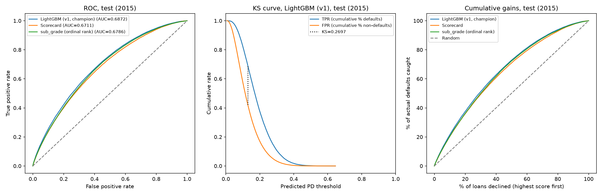
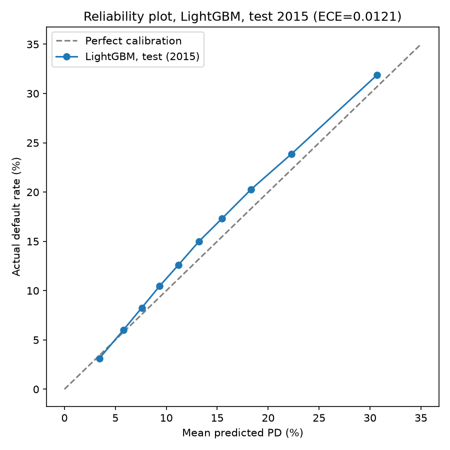
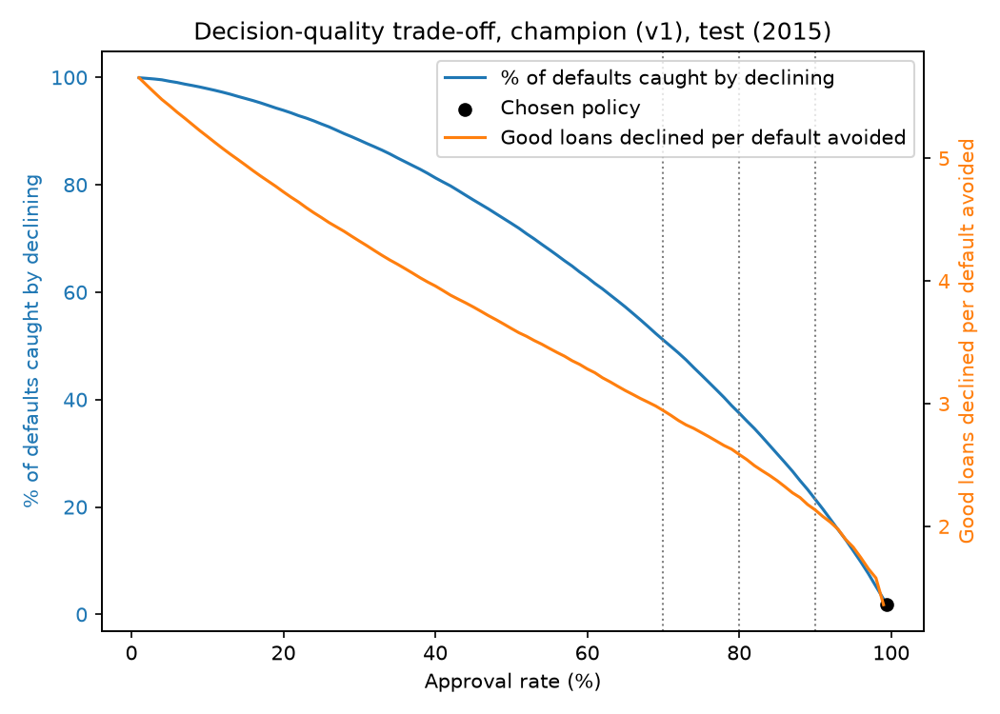

# Credit Default Risk Engine

[](https://github.com/Niveditha-04/Credit-Default-Risk-Engine/actions/workflows/ci.yml)

I built a model that scores the lifetime default risk of a LendingClub loan, using only what was known at origination. The view is an investor's: which already-accepted loans to fund, not who to approve in the first place.

[Read the one-page decision memo](docs/decision_memo.md) for the plain-English recommendation.

## Results at a glance

| Metric | Value |
|---|---|
| v1 AUC vs. scorecard | **+0.0162**, significant |
| v1 AUC vs. sub_grade | **+0.0086**, significant, **12/12** months positive |
| Return per $100 at 70% funding (v1 / scorecard / sub_grade) | **$7.57** / $7.28 / $6.97 |
| v2 AUC, 2016 holdout (24-month label) | **0.6978** |
| Decision quality at 70% approval (defaults caught / good loans declined per default avoided) | **51.1%** / **2.94** |





## Data

LendingClub accepted loans, 2007 to 2018 (public Kaggle copy, Nathan George, CC0). Modeling population: 36-month, individual-application loans.

| Split | Issue years | Loans | Default rate | Use |
|---|---|---|---|---|
| Train | 2012-2013 | 143,892 | 12.70% | Fit models |
| Validation | 2014 | 162,570 | 13.73% | Tune, calibrate, set threshold |
| Test | 2015 | 282,787 | 14.88% | Read once, at the end |
| Replay | 2016-2018 | 919,053 | not used | Drift checks only |

## What I did

- Built an allow-list down to 69 origination-time features (59 raw, 10 engineered), out of 151 raw columns.
- Built a WOE-binned logistic scorecard as the baseline.
- Trained LightGBM (champion) and XGBoost, both tuned and calibrated on validation only.
- Set one approval cutoff on validation by maximizing expected net value, applied it to test once.
- Explained every prediction with LightGBM's own exact TreeSHAP, served through FastAPI in Docker.
- Checked drift over 2016-2018 as a historical PSI replay, and tested the pipeline in CI.

## Results

All models, features, and the approval threshold were frozen on validation before test was read. Every test read after the first is post-hoc and logged (`reports/metrics/test_access_log.json`).

| Model | AUC (95% CI) | Gini | KS | Brier |
|---|---|---|---|---|
| LightGBM (v1) | **0.6872** (0.6847-0.6898) | 0.3745 | 0.2697 | 0.1197 |
| XGBoost | 0.6886 (0.6859-0.6912) | 0.3772 | 0.2725 | 0.1195 |
| Scorecard | 0.6711 (0.6686-0.6735) | 0.3421 | 0.2480 | 0.1211 |
| sub_grade | 0.6786 (0.6760-0.6812) | 0.3573 | 0.2619 | 0.1215 |

XGBoost is ahead by **0.0014**, within the **0.0007** retraining-noise spread; I kept LightGBM, chosen on validation, **273** vs. **2,122** trees.

Return per $100 funded, 0% cost of funds (`reports/metrics/posthoc_matched_volume_economics.csv`):

| Model | 70% | 80% | 90% |
|---|---|---|---|
| LightGBM | **$7.57** | $7.30 | $6.99 |
| XGBoost | $7.55 | $7.34 | $6.99 |
| Scorecard | $7.28 | $7.04 | $6.80 |
| sub_grade map | $6.97 | $6.88 | $6.74 |

Decision quality, LightGBM exact rank on test (`reports/metrics/test_decision_quality.csv`):

| Approval rate | Default rate approved | Defaults caught | Good loans declined per default avoided | Realized net cash |
|---|---|---|---|---|
| 70.00% | 10.40% | **51.10%** | **2.94** | $196.9M |
| 90.00% | 12.99% | 21.44% | 2.13 | $228.9M |
| 99.41% (chosen policy) | 14.70% | 1.79% | 1.23 | $231.6M |

## v1 vs. v2

v2 is the model the API serves now, chosen over v1 by a pre-registered rule (`docs/v2_decision_rule.md`).

| | v1 | v2 |
|---|---|---|
| Trained on | 2012-2013 | 2012-2014 |
| Monotone constraints | none | **8** |
| AUC, 2016 holdout (24-month label) | 0.6899 | **0.6978** |
| AUC, 2015 test (post-hoc) | 0.6872 | **0.6959** |
| Served now | no (history) | **yes** |

## Findings

- **AUC is not money:** at validation-set cutoffs, LightGBM and the scorecard realize almost the same cash (0 to 1.1% apart); ranking by each model's own score instead shows a real, significant edge (**+0.28 pp** at 70%, 0% cost of funds).
- **The sub_grade paradox:** adding `sub_grade` as a feature raises validation AUC by **+0.0057** but lowers realized return (**7.49%** vs. **7.57%** at 70% funded): `sub_grade` partly prices risk, not just ranks it.
- **DTI cap moved:** LendingClub's own DTI ceiling rose from **34.99%** (train) to **49.96%** (2016); v1 under-predicts loans above its own cap by **+5.07 pp** vs. **+1.01 pp** in range.
- **Retraining gain:** one more year of data (2012-2014 vs. 2012-2013) raises test AUC from **0.6872** to **0.6962**.
- **Rate, not mix:** **7 of 11** month-over-month 2015 default-rate changes exceed sampling noise; the moves are within-segment rate shifts, not a change in applicant mix (mean mix effect **0.08 pp** vs. rate effect **0.77 pp**).
- **AUC is range-restricted:** FICO stayed at or above **660** in every year used, and LendingClub had already pre-screened every applicant before this data existed (`reports/metrics/eligibility_caps_by_year.csv`).

Ex-ante expected value overstated realized cash by **$44.6M**: **$21.9M** default-rate drift, **$12.9M** prepayment, **$7.3M** loss severity, **$2.4M** unexplained (`reports/metrics/test_gap_decomposition_lightgbm.json`, `reports/metrics/test_gap_remainder_diagnostic.json`).

## Drift (historical replay, 2015-2018)

6 of 69 features crossed the alert threshold (PSI > 0.25); none are in the top-10 SHAP features.

| Feature | Peak PSI | SHAP rank (of 69) |
|---|---|---|
| verification_status | 0.52 | 38 |
| bc_util | 0.44 | 18 |
| revol_util | 0.43 | 13 |
| percent_bc_gt_75 | 0.43 | 14 |
| bc_open_to_buy | 0.31 | 11 |
| num_tl_120dpd_2m | 0.29 | 62 |

- 3 of the top-10 SHAP features reached watch (fico_mean 0.1513, purpose 0.1421, loan_to_income 0.1202); none reached alert.
- This is a replay of closed historical periods, not live monitoring.


## What drives the model (SHAP, full test set)

| Rank | Feature | Mean \|SHAP\| (log-odds) |
|---|---|---|
| 1 | fico_mean | 0.2166 |
| 2 | annual_inc | 0.1330 |
| 3 | acc_open_past_24mths | 0.1309 |
| 4 | loan_to_income | 0.1306 |
| 5 | dti | 0.0994 |
| 6 | purpose | 0.0903 |
| 7 | num_tl_op_past_12m | 0.0771 |
| 8 | mths_since_recent_inq | 0.0724 |
| 9 | mths_since_recent_bc | 0.0702 |
| 10 | home_ownership | 0.0690 |

- Every direction matches intuition: higher FICO lowers risk, higher DTI and loan-to-income raise it.
- `annual_inc` alone is most protective around $90K-110K, then weakens above that; a monotone-constrained variant (v2's ablation) removes most of this reversal.


## Limitations

- Accepted loans only: I never see applicants LendingClub rejected.
- Modeling data is 2012-2015, plus a 2016 holdout check for v2; no claim beyond that window.
- No protected attributes in this data, and none built as proxies, so no fairness test was run.
- Loss rate on funded amount (cash basis, 38.03%) is an estimate from train-year charged-off loans; a sensitivity table is in `reports/metrics/test_lgd_sensitivity.csv`.
- Drift monitoring replays closed historical periods; it has never run against a live feed.

## How to run

```bash
make setup && make data && make features && make train && make promote-v1
make calibrate && make freeze && make evaluate && make drift
make promote   # refits v2, writes to candidates/ only; add PROMOTE_V2_FLAG=--promote to deploy
make test      # pytest, synthetic fixtures only
make serve     # FastAPI dev server
docker build -t credit-default-risk-engine:latest . && docker run -d --rm -p 8000:8000 --name cdre credit-default-risk-engine:latest
curl -s -X POST http://localhost:8000/score -H "Content-Type: application/json" -d @docs/api_example.json
```

`make data` needs `accepted_2007_to_2018Q4.csv.gz` in `data/raw/` (not included). On macOS, LightGBM needs `brew install libomp`; the Docker image installs `libgomp1`. More detail, including the full API schema and latency numbers, is in `docs/validation_report.md`.

## License and data credit

Code is MIT-licensed (`LICENSE`). Data is LendingClub's accepted-loan data via a public Kaggle copy (Nathan George); `data/` is gitignored and not redistributed here.
