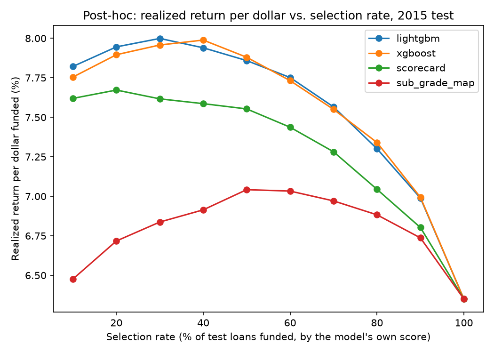
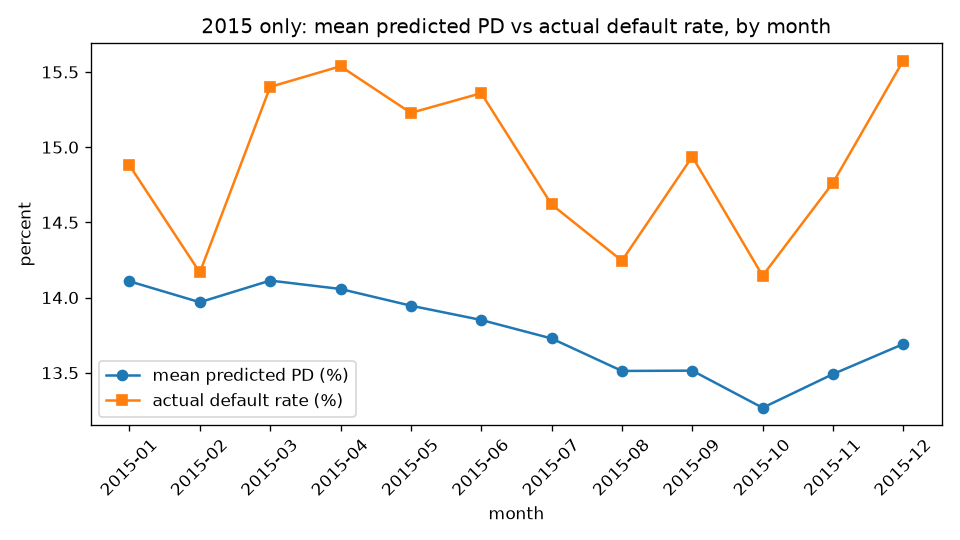

# Credit Default Risk Engine

[](https://github.com/Niveditha-04/Credit-Default-Risk-Engine/actions/workflows/ci.yml)

I built an origination-time credit scoring model for LendingClub loans: given only what LendingClub knew the moment it already accepted a 36-month loan, predict the probability that loan ends in default over its lifetime. This is loan selection among loans LendingClub has already accepted, the view an investor buying into these loans would take, not an underwriting model deciding who gets a loan in the first place. More than a notebook with one accuracy number: a time-based split, a scorecard baseline, an expected-loss selection policy, explanations for every prediction, and a served model monitored for drift after launch.

## Results at a glance

- LightGBM (AUC 0.6872) beats LendingClub's own sub_grade (AUC 0.6786) on test, 2015: +0.0086 AUC, 95% CI 0.0063 to 0.0109, significant.
- LightGBM also beats the scorecard baseline (AUC 0.6711) by +0.0162 AUC, 95% CI 0.0146 to 0.0178, significant.
- `fico_mean` is the strongest driver on average (mean |SHAP|).
- Served through FastAPI in Docker at 16.29 ms p50 latency; 282 tests pass, 279 of them in CI.

## Data

I used LendingClub's accepted-loan data, 2007 to 2018, from a public Kaggle copy uploaded by Nathan George (listed as CC0). The original data was published under LendingClub's own terms at the time. I do not redistribute the raw file; it stays local and gitignored.

- Raw file: `accepted_2007_to_2018Q4.csv.gz`, SHA-256 `dd972c625896155b388224f3ce729e921dae7a9278af579f5a1d72ab49b632ce` (`reports/metrics/raw_data_profile.json`). 2,260,701 rows, 151 columns, 33 footer/summary rows removed, 2,260,668 real loan rows left. My modeling population: 36-month, individual-application loans only. Time-based split, so I never shuffle across time:

| Split | Issue years | Loans | Default rate | Use |
|---|---|---|---|---|
| Train | 2012 to 2013 | 143,892 | 12.70% | Fit models, bin variables, estimate the loss rate |
| Validation | 2014 | 162,570 | 13.73% | Tune, calibrate, choose the selection threshold |
| Test | 2015 | 282,787 | 14.88% | Scored once, at the end, for the final numbers |
| Replay | 2016 to 2018 | 919,053 | not used | Drift checks only, outcomes not yet resolved for most of this window |

I start the modelling population at 2012 for two reasons: 36-month loans issued 2007 to 2011 are only 31,534 loans total, and a wave of bureau trade-line fields (`mths_since_recent_inq`, `bc_util`, and others) does not exist in LendingClub's schema before 2012, arriving between March and August that year (`reports/metrics/field_rollout.csv`). I use 36-month loans only because 60-month loans issued after 2013 are not fully resolved by this data's March 2019 snapshot (82.85% resolved for 2014, 67.08% for 2015, versus 99.97%+ for 36-month loans issued through 2013) - see `reports/metrics/maturity_audit.csv`. Replay (2016 to 2018) carries no labels for the same reason at a larger scale: by the March 2019 snapshot, as little as 11.97% of 2018's 36-month loans have resolved, so any label I computed there would mostly describe loans still in progress, not real outcomes.

In the 2015 test population, 147 loans were still unresolved (72 Current, 61 Late 31-120 days, 9 In Grace Period, 5 Late 16-30 days) and are excluded from the labeled population, not counted as either outcome.

## How I defined default

Target is 1 if `loan_status` is Charged Off or Default. Target is 0 if `loan_status` is Fully Paid (a loan that pays off early cannot default afterward, so I count it as 0, not excluded). I exclude Current, In Grace Period, both Late buckets, and any "does not meet the credit policy" loan, because none of those have a resolved outcome yet. This is lifetime default of a 36-month loan, not default within some fixed window after issuance.

## Approach

- Built an explicit allow-list for all 151 raw columns: 59 kept as model features, 12 kept as metadata only (dates, state, zip, grade, for filtering and stability checks, never fed to a model), 1 is the target source (`loan_status`), 79 dropped.
- Engineered 10 features from origination-time data only: `fico_mean`, `credit_history_months`, `loan_to_income`, `revol_bal_to_income`, and 6 "never happened yet" flags for the `mths_since_*` columns.
- Built a WOE-binned logistic scorecard as the baseline, then trained LightGBM as the main model and XGBoost as a comparison, both tuned and calibrated on validation only and logged to MLflow.
- Picked one selection cutoff on validation by maximizing total expected net value, then applied that same fixed cutoff to test, once.
- Explained every prediction with LightGBM's own exact TreeSHAP on the full test set, and served the champion through FastAPI with reason codes, in a Docker image.
- Checked drift over 2016 to 2018 with PSI as a historical replay, and tested the target logic, population filters, PSI math, and the API in CI.

## Results on test (2015)

| Model | AUC (95% CI) | Gini | KS | Brier | Brier skill score | AUC diff vs. LightGBM (95% CI) |
|---|---|---|---|---|---|---|
| LightGBM (champion) | 0.6872 (0.6847 to 0.6898) | 0.3745 | 0.2697 | 0.1197 | 0.0555 | n/a |
| XGBoost (comparison) | 0.6886 (0.6859 to 0.6912) | 0.3772 | 0.2725 | 0.1195 | 0.0564 | -0.0014 (-0.0020 to -0.0008) |
| Scorecard | 0.6711 (0.6686 to 0.6735) | 0.3421 | 0.2480 | 0.1211 | 0.0445 | +0.0162 (0.0146 to 0.0178) |
| LendingClub sub_grade | 0.6786 (0.6760 to 0.6812) | 0.3573 | 0.2619 | 0.1215 | 0.0407 | +0.0086 (0.0063 to 0.0109) |

All three differences are statistically significant (95% bootstrap CI, 1,000 resamples). XGBoost edges out LightGBM by a small but significant margin; both gradient-boosted models beat the scorecard and sub_grade by a larger margin. I deployed LightGBM anyway: it is within 0.0021 AUC of XGBoost on validation, using 273 trees against XGBoost's 2,122 (both searches ran 20 tuning trials; LightGBM's champion also had a second, 10-trial regularized search on top of that; the tree-count gap comes mostly from LightGBM's higher learning rate, 0.08 against XGBoost's 0.01). Retraining noise alone moves validation AUC by about 0.0007 (`reports/metrics/training_order_sensitivity.json`), so I treat the two as statistically detectable but effectively tied.

A statistically significant AUC gap does not mean a large difference in money. At matched selection rates (see the table below), LightGBM and the scorecard realize nearly the same cash: $196.8M vs. $198.9M at 70%, $213.7M vs. $213.7M at 80%, $228.3M vs. $225.9M at 90%, a 0 to 1.1% difference. Riskier loans carry higher interest, so a model's ranking advantage mostly cancels out at the portfolio level under this objective. I do not show an economic value for the AUC gap itself; it is a ranking-quality result, not a profit result.

## Fixed selection-rate comparison (test, cutoffs set on validation, $ in millions)

| Model | Target selection rate | Actual selection rate on test | Actual default rate funded | Ex-ante expected net value | Ex-post realized net cash |
|---|---|---|---|---|---|
| LightGBM | 70% | 69.91% | 10.38% | $218.4M | $196.8M |
| LightGBM | 80% | 79.59% | 11.59% | $242.8M | $213.7M |
| LightGBM | 90% | 89.47% | 12.91% | $264.2M | $228.3M |
| Scorecard | 70% | 72.02% | 11.00% | $235.7M | $198.9M |
| Scorecard | 80% | 81.35% | 12.08% | $259.4M | $213.7M |
| Scorecard | 90% | 90.54% | 13.26% | $279.5M | $225.9M |
| sub_grade map | 70% | 75.57% | 11.33% | $209.5M | $192.3M |
| sub_grade map | 80% | 84.59% | 12.46% | $237.9M | $210.4M |
| sub_grade map | 90% | 92.88% | 13.59% | $266.6M | $224.6M |

Only XGBoost's test predictions were saved, so it appears in the main results but not in this table. sub_grade can't hit a target rate exactly either: it has only 35 discrete levels, so its actual rate on test misses the target by a point or more.

## Key findings

- My ex-ante expected net value ($276.2M) overstates the actual realized net cash ($231.6M) by $44.6M (16.2% of ex-ante). Breaking that gap down by cause:

| Cause | $M | % of gap |
|---|---|---|
| Default-rate drift (calibration fit on 2014 at 13.73% default, test 2015 ran at 14.88%) | $21.9M | 49.1% |
| Prepayment (fully paid test loans collected less of their scheduled interest than train-year fully paid loans did, 80.24% vs. 82.62%) | $12.9M | 29.0% |
| Loss severity (charged-off test loans lost more of their funded amount than train-year charged-off loans did, 39.47% vs. 38.03%) | $7.3M | 16.4% |
| Unexplained | $2.4M | 5.5% |

I subtract default-rate drift first, then split what's left between prepayment and loss severity, so the prepayment/loss-severity split specifically depends on that order; a different order could move money between those two rows without changing the total explained.
- Loss on a charged-off loan: I use loss rate on funded amount (cash basis), `1 - (total payment received - collection/recovery fee) / funded amount`, averaging 38.03% on train charged-off loans; this is what feeds the expected-loss model. The standard LGD definition on outstanding principal at charge-off (recoveries net of fees, over principal still owed) averages 89.06% on the same loans; I use the cash-basis version because it is the one I can verify directly against dollars actually paid.
- A stricter selection policy means less total cash, not more: LightGBM realizes $196.8M at 70% selection and $228.3M at 90%, against $231.6M for the chosen policy (99.41% of test loans selected), since riskier loans also carry higher interest and funding more of them raises total cash even as more default. No cost of capital, operating cost, or time value of money here, and this is accepted-loans-only data, so I cannot say what would have happened to a loan LendingClub itself never accepted.
- A stricter robustness check (default within 24 months of issue, from payment dates, labeling only) gives a different default rate (11.93% vs. 14.88%) but the same model ranking: XGBoost, LightGBM, sub_grade, scorecard, in that order, on both labels.

## Ablations and robustness (post-hoc)

Four ablations, fit with the champion's own frozen hyperparameters (no tuning search). Validation (2014) is the primary number for every ablation, same as the champion itself; test (2015) AUC is reported for context only and is explicitly **post-hoc**, since none of these were fit or compared before test was touched for the main evaluation.

Absolute validation AUC for every ablation, with the deployed scorecard and the champion itself as reference rows, in the order they build on each other:

| Model | Validation AUC | Test AUC (post-hoc) |
|---|---|---|
| Scorecard (deployed: 17 features, WOE, correlation/VIF/sign-correction reduction) | 0.6650 | 0.6711 |
| a. LightGBM on the scorecard's same 17 (reduced) features | 0.6738 | 0.6787 |
| b. WOE logistic regression on all 63 scorecard candidates, no reduction | 0.6684 | 0.6735 |
| Champion (LightGBM, 69 features) | 0.6834 | 0.6872 |
| c. LightGBM, champion features + sub_grade | 0.6891 | 0.6967 |
| d. LightGBM, champion features, 8 monotone constraints | 0.6833 | 0.6871 |

- **Where the lift comes from:** swapping logistic regression for LightGBM on the scorecard's own 17 features already recovers most of the gap to the champion (0.6650 to 0.6738, a). Skipping the scorecard's correlation/VIF reduction and fitting WOE logistic regression on all 63 raw candidates (b) scores 0.6684, slightly above the deployed, reduced scorecard, not below it - so the reduction step is not what costs AUC; it produces 15 sign-mismatched coefficients instead, an interpretability and stability problem, not a ranking one. Going from 17 to the champion's 69 features adds the rest (0.6738 to 0.6834). Adding `sub_grade` on top of those 69 still adds +0.0057 (c), so LendingClub's own grading carries a little information the model doesn't fully recover from the raw fields alone. Constraining 8 business-obvious features to a single direction (fico_mean down, dti up, and others) costs essentially nothing (0.6834 to 0.6833, d) and the income SHAP reversal I flagged earlier mostly disappears under it: the post-peak swing in mean SHAP for `annual_inc` shrinks from 0.093 to 0.004 log-odds, about a 96% reduction (`reports/metrics/posthoc_ablations_summary.json`).
- **A candidate for the next version:** the monotone-constrained model (d) costs about -0.0001 validation AUC and removes most of the income non-monotonicity, which is easier to defend to a reviewer than the champion's current income shape. I have not swapped the champion for it here, since test (2015) was already touched for the frozen champion and swapping now would mean picking a model with test information in hand - a decision for a genuinely new model-selection round, not a same-round edit.
- **Does the lift hold month by month:** paired monthly AUC, all 12 months of test (2015): LightGBM beats sub_grade's ordinal rank every month (mean +0.0082, range +0.0043 to +0.0165) and beats the scorecard every month (mean +0.0161, range +0.0107 to +0.0213) (`reports/metrics/posthoc_monthly_lift.csv`).
- **Does it pay at matched volume:** funding each model's own top 70/80/90% of test loans by its own score (an evaluation device, not the deployed policy), LightGBM's realized return per dollar funded (over the loan's observed life, not annualized) is highest at every rate, with a paired bootstrap 95% CI (1,000 resamples) on each difference that never crosses zero:

| Selection rate | LightGBM | Scorecard | sub_grade map | LightGBM minus scorecard (95% CI) | LightGBM minus sub_grade (95% CI) |
|---|---|---|---|---|---|
| 70% | 7.57% | 7.28% | 6.97% | +0.28 pp (0.22 to 0.34) | +0.59 pp (0.52 to 0.67) |
| 80% | 7.30% | 7.04% | 6.88% | +0.26 pp (0.21 to 0.30) | +0.42 pp (0.36 to 0.49) |
| 90% | 6.99% | 6.80% | 6.74% | +0.19 pp (0.15 to 0.22) | +0.25 pp (0.20 to 0.30) |

Unlike the fixed-cutoff comparison above (set on validation, nearly tied), ranking loans by each model's own score does turn into significantly more realized cash per dollar at matched volume. The same pattern (LightGBM ahead of both, every difference significant) holds at 4% and 8% annual cost of funds too - see `docs/validation_report.md` for the full table (`reports/metrics/posthoc_matched_volume_comparison_table.csv`).



- **Does it hold walking forward in time:** a 2-fold walk-forward check with the champion's frozen hyperparameters (fold 1: train 2012-2013, evaluate validation 2014, reusing the already-committed numbers; fold 2: train 2012-2014, evaluate test 2015, post-hoc) gives a positive lift over both comparisons in both folds: mean +0.0204 vs. the scorecard (range +0.0184 to +0.0223) and mean +0.0207 vs. sub_grade (range +0.0175 to +0.0238) (`reports/metrics/posthoc_walkforward.csv`).
- **Does it hold on replay under a stricter label:** loans issued January 2016 to March 2017 have all had at least 24 months to season by this data's March 2019 snapshot, so a fixed 24-month-default label is computable for them (exploratory, post-hoc, 6,315 of 388,055 loans excluded as unlabelable slow charge-offs). AUC under this label ranges 0.6747 to 0.7045 across the 5 replay quarters, overlapping the same label's 0.6877 to 0.7009 range on test (2015) - no sign of degraded discrimination on more recent originations under this check (`reports/metrics/posthoc_replay_24m_performance.csv`).

- **Calibration in more detail:** Expected Calibration Error 0.0121 (10 bins); predicted and actual default rates stay within about 1.9 percentage points of each other whether cut by issue month or by FICO band (`reports/figures/posthoc_reliability_plot.png`).
- **Where it works best:** LightGBM's AUC on test rises with FICO band (0.6481 at the riskiest band to 0.7417 at the safest) and with loan size (0.6596 to 0.7124) - the model discriminates better among safer, larger loans, where there's more room between a typical good and bad outcome. By purpose, AUC ranges 0.6677 to 0.6945 (`reports/metrics/posthoc_segment_table.csv`).

More detail, including the cost-of-funds sensitivity table and the full segment and calibration breakdowns, is in `docs/validation_report.md`.

## Drift findings (historical replay, 2015 to 2018, not live monitoring)

Leading with the two numbers that matter most for whether the model itself can be trusted to keep working: prediction drift (the model's own score distribution vs. train) stayed low, max monthly PSI 0.0549, never crossing the 0.10 "watch" threshold. And every one of the top-10 SHAP features stays "stable" against the closest reference (validation 2014 vs. train, max 0.0326) and never reaches "alert" against the full 2015-2018 reference either - the closest any of them gets is `purpose` at 0.1421 ("watch"). I only checked performance drift for 2015, since 2015 is the last year with labels: monthly test AUC ranged from 0.679 to 0.695, no clear trend down, and I make no performance-drift claim for 2016 to 2018.

PSI bins are fit on train only and reused unchanged for every later month: numeric features get 10 train-decile bins (edges widened to the whole real line so a future value outside train's range still lands somewhere), categorical features get train's observed categories, and missing values get their own separate bin in both cases. A small epsilon (0.0001) replaces an empty bin's share before the log step, so one empty bin doesn't blow up the whole feature's PSI to infinity.

I checked monthly PSI for 69 features over 48 months, train as the baseline (plus validation 2014 vs. train as a second, closer-in-time reference). By end of 2018, 23 of 69 crossed the 0.10 "watch" threshold at least once, 6 crossed the 0.25 "alert" threshold: `verification_status` (0.52), `bc_util` (0.44), `revol_util` (0.43), `percent_bc_gt_75` (0.43), `bc_open_to_buy` (0.31), `num_tl_120dpd_2m` (0.29). None of these 6 are top-10 SHAP drivers; they rank 11 to 62 of 69 by SHAP importance. `verification_status`'s drift is the largest by far (0.52, and already at 0.17, "watch", against validation alone); since it is a label LendingClub assigns about its own verification process rather than something about the borrower, I read this as LendingClub changing how it categorizes or applies verification over time, not a shift in who is borrowing. The full 69-feature table, both references side by side with each feature's SHAP rank, is in `docs/validation_report.md` (`reports/metrics/drift_combined_psi_table.csv`).




## What drives the model (SHAP, full test set, no sampling)

LightGBM's own exact TreeSHAP (`pred_contrib=True`), checked for additivity against the model's raw output.


| Rank | Feature | Mean \|SHAP\| (log-odds) |
|---|---|---|
| 1 | fico_mean | 0.2166 |
| 2 | annual_inc | 0.1330 |
| 3 | acc_open_past_24mths | 0.1309 |
| 4 | loan_to_income | 0.1306 |
| 5 | dti | 0.0994 |
| 6 | purpose | 0.0903 |
| 7 | num_tl_op_past_12m | 0.0771 |
| 8 | mths_since_recent_inq | 0.0724 |
| 9 | mths_since_recent_bc | 0.0702 |
| 10 | home_ownership | 0.0690 |

Every direction matches intuition: higher FICO lowers risk, higher DTI and loan-to-income raise it. `annual_inc` alone is most protective around $90K-110K (mean SHAP -0.24), then weaker above, settling near -0.14 to -0.15 from $150K up. Grouped with the other two income-scaled features (`loan_to_income`, `revol_bal_to_income`), the combined effect stays in a -0.22 to -0.30 band above $90K rather than trending back toward zero like `annual_inc` alone (`reports/metrics/shap_income_group_reversal_check.csv`). All 15 shared numeric features agree in direction between SHAP and the scorecard's WOE.

API latency numbers (p50/p95/p99, with and without reason codes) are in `docs/validation_report.md`.

## Tests and coverage

282 tests total: 279 run in CI against small synthetic fixtures, 3 need the real trained model and run locally only. Coverage, for the core library modules (`src/features`, `src/data/target.py`, `src/monitoring/psi.py`, `src/api`):

| File | Coverage |
|---|---|
| src/api (main, schemas, scoring, reason_codes); src/features/feature_engineering.py; src/monitoring/psi.py | 100% |
| src/features/build_features.py | 98.51% |
| src/features/allow_list.py | 98.28% |
| src/data/target.py | 97.87% |

The rest of those four modules are one-time pipeline scripts I run by hand against real data, not pytest tests, so they show 0% here.

## How to run

```bash
make setup      # Python 3.11 venv, pinned dev deps (pytest, ruff, the notebook tools, and everything in requirements.txt)
make data       # raw csv.gz -> cleaned, typed parquet (skipped if the raw file's hash already matches)
make features   # allow-list + origination-time features
make train      # scorecard only, logged to MLflow
make promote    # LightGBM/XGBoost tuning search, then copies the result over the frozen artifacts and registers it in MLflow
make calibrate  # out-of-sample Platt calibration for the two comparison models (XGBoost, scorecard)
make freeze     # write frozen_model_config.json, the one file the evaluation loads everything from
make evaluate   # test metrics, benchmark, economics
make serve      # FastAPI dev server
make test       # pytest, synthetic fixtures only
make drift      # historical PSI replay, 2015 to 2018
# or: make reproduce, which chains all of the above in order
docker build -t credit-default-risk-engine:latest .
docker run -d --rm -p 8000:8000 --name cdre credit-default-risk-engine:latest
curl -s http://localhost:8000/health
curl -s -X POST http://localhost:8000/score -H "Content-Type: application/json" -d '{
  "loan_amnt": 15000.0, "annual_inc": 65000.0, "dti": 18.5, "fico_range_low": 680.0, "fico_range_high": 684.0, "earliest_cr_line": "2005-03-01",
  "home_ownership": "RENT", "purpose": "debt_consolidation", "verification_status": "Verified", "emp_length": 5.0, "revol_util": 45.0, "revol_bal": 8000.0,
  "open_acc": 10.0, "total_acc": 20.0, "pub_rec": 0.0, "pub_rec_bankruptcies": 0.0, "inq_last_6mths": 1.0, "mort_acc": 1.0, "acc_open_past_24mths": 3.0
}'
docker stop cdre
```

`make data` needs `accepted_2007_to_2018Q4.csv.gz` in `data/raw/` (not included, see Data above). On macOS, LightGBM needs `brew install libomp` first; the Docker image installs `libgomp1` on Linux. See `docs/validation_report.md` for the calibrator selection rule.

The request above sends 20 of the schema's 63 fields; everything else defaults to missing. `/score` still scores it, but the response lists what it didn't get (`missing_fields`) and warns when a missing field is one of the model's top-10 global SHAP drivers (`warnings`, `reason: missing_top10_shap_feature_lowers_fidelity`), since the served score then runs on less information than the model saw on most of its training rows. Sending all 63 fields avoids this. A trimmed response for the request above:

```json
{
  "request_id": "f3a1...",
  "calibrated_pd": 0.1186,
  "risk_band": "Medium",
  "top_3_risk_increasing_drivers_illustrative_only": [
    {"feature": "fico_mean", "plain_english": "credit score (FICO)", "shap_value_log_odds": 0.164116},
    {"feature": "mths_since_recent_bc", "plain_english": "months since most recent bankcard account opened", "shap_value_log_odds": 0.056168},
    {"feature": "home_ownership", "plain_english": "home ownership status", "shap_value_log_odds": 0.045984}
  ],
  "model_name": "lightgbm_chosen",
  "model_version": "lightgbm_chosen@git:53597a48f88c+sha256:b8437eb84d6a",
  "missing_fields": ["acc_now_delinq", "avg_cur_bal", "bc_open_to_buy", "..."],
  "warnings": [
    {"field": "mths_since_recent_bc", "reason": "missing_top10_shap_feature_lowers_fidelity", "value": "missing"},
    {"field": "mths_since_recent_inq", "reason": "missing_top10_shap_feature_lowers_fidelity", "value": "missing"},
    {"field": "num_tl_op_past_12m", "reason": "missing_top10_shap_feature_lowers_fidelity", "value": "missing"}
  ]
}
```

## Project structure

```
src/
  data/               load, clean, define the target and the time split
  features/           allow-list and origination-time feature engineering
  models/             scorecard, LightGBM/XGBoost, calibration, MLflow
  evaluation/         test metrics, selection economics, benchmarks
  explain/            SHAP
  monitoring/         PSI drift and historical replay
  api/                FastAPI serving app
tests/                pytest, synthetic fixtures only
reports/              metrics/ (computed values), figures/ (saved plots), drift/ (HTML reports, gitignored)
docs/                 model card, validation report, data audit
notebooks/            EDA viewing only
config/               allow_list.csv, the column-by-column keep/drop decisions
.github/workflows/    CI: install, lint, test
Dockerfile            serving image
Makefile              setup/data/features/train/promote/calibrate/freeze/evaluate/serve/test/drift/reproduce
requirements.txt        core pipeline dependencies
requirements-serve.txt  the smaller set the Docker image actually installs
requirements-dev.txt    requirements.txt plus pytest, ruff, and the notebook tools
```

See [`docs/model_card.md`](docs/model_card.md), [`docs/validation_report.md`](docs/validation_report.md), and [`docs/data_audit.md`](docs/data_audit.md) for more detail than fits here.

## Limitations

- Accepted loans only. I never see loans LendingClub rejected, so I cannot evaluate the model on applicants who were turned down.
- This uses origination-time data, what LendingClub recorded when the loan was issued, not necessarily the exact instant someone applied.
- US data, 2012 to 2015 only. I make no claim this generalizes to other lenders, other countries, or other years.
- No protected attributes are in this data, and I did not create proxies for them, so I did not run a proxy-based disparate impact test. BISG (Bayesian Improved Surname Geocoding, the standard proxy method for this) needs a surname field this data does not have. A zip3-level analysis against Census demographics is possible future work, not done here.
- Fully paid loans in this data include prepayments, and prepayment is a competing risk alongside default: a loan that pays off early can no longer default afterward. I treat it as the 0 class here; a survival or competing-risk hazard model that estimates default and prepayment together over time is a natural next step, not something this project does.
- Drift monitoring here replays already-closed historical periods against a fixed reference; it was never run against a live incoming feed.
- The loss rate on funded amount (cash basis) is estimated from train-year charged-off loans, an approximation; a sensitivity table over a range of loss-rate values is in `reports/metrics/test_lgd_sensitivity.csv`.
- Training uses seeded bagging, which depends on row order. Retraining reproduces the champion to within about 0.001 validation AUC, not bit for bit (`reports/metrics/training_order_sensitivity.json`).

## License and data credit

The code in this repository is released under the MIT license (see `LICENSE`). The data is not mine to redistribute: I used LendingClub's accepted-loan data, 2007 to 2018, from a public Kaggle copy uploaded by Nathan George, and `data/` is gitignored so it never enters this repository. Anyone who wants to run this project needs to get the data themselves, under LendingClub's and Kaggle's own terms.
